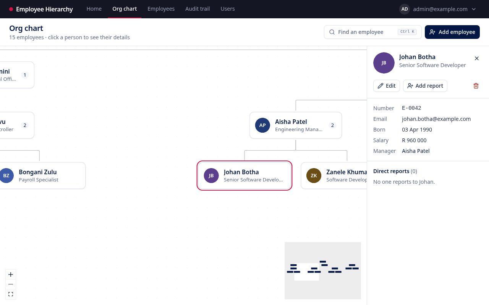
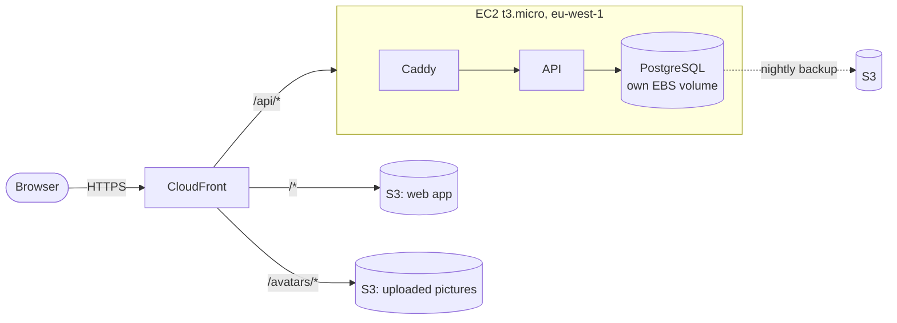

# Employee Hierarchy

A cloud-hosted employee hierarchy manager, built for the EPI-USE technical assessment ([brief](docs/Technical%20Services%20-%20Assessment%20v2.1.pdf)). Employees, their reporting lines and an audit trail are stored in PostgreSQL, browsed as an interactive org chart or a sortable, filterable table, and edited by admins.

**Live:** https://d1qxvq2ahpxf8h.cloudfront.net

Sign-in details are shared separately. The two seeded accounts are `admin@example.com` (full access) and `viewer@example.com` (read-only, salaries hidden).



## Documentation

| Document                                               | For                   | What it covers                                                 |
| ------------------------------------------------------ | --------------------- | -------------------------------------------------------------- |
| [User guide](docs/user-guide.md)                       | People using the app  | Every screen and task, with screenshots                        |
| [Technical document](docs/technical-document.md)       | Assessors, developers | Architecture, design patterns, technologies and why            |
| [Requirements (SRS)](docs/srs.md)                      | Assessors, developers | Every requirement, its source, and how it is verified          |
| [User stories](docs/user-stories.md)                   | Everyone              | The problem, the people, and how each need is met              |
| [Diagrams](docs/diagrams.md)                           | Developers            | Context, deployment, request path, data model, flows, pipeline |
| [Brand and style guide](docs/brand-and-style-guide.md) | Designers, developers | Colour, type, components, writing and formats                  |
| [Decision records](docs/adr/README.md)                 | Developers            | Each decision, the alternatives, and what was given up         |
| [Infrastructure runbook](infra/README.md)              | Operators             | Creating, deploying, backing up and tearing down on AWS        |

## What is in the repository

| Path                                 | What it is                                                                             |
| ------------------------------------ | -------------------------------------------------------------------------------------- |
| [`apps/api`](apps/api)               | NestJS API, Prisma migrations and seed, production Dockerfile                          |
| [`apps/web`](apps/web)               | React + Vite single-page app, unit tests and the Playwright end-to-end suite           |
| [`packages/shared`](packages/shared) | Zod schemas shared by both: every request and response shape, defined once             |
| [`deploy`](deploy)                   | What the server runs: Compose file (PostgreSQL, API, Caddy), deploy and backup scripts |
| [`infra`](infra)                     | Terraform for AWS, with its own [runbook](infra/README.md)                             |
| [`e2e`](e2e)                         | The Docker stack the end-to-end tests run against, with a CloudFront stand-in          |
| [`scripts`](scripts)                 | `e2e-docker.sh`: build, seed, test and tear down that stack                            |
| [`docs`](docs)                       | The documents above, screenshots and the brief                                         |

## How it fits together



One URL serves everything, so there is no CORS and the refresh cookie is same-site ([ADR-0016](docs/adr/0016-single-cloudfront-distribution-dual-origin.md)). More views are in [diagrams.md](docs/diagrams.md). The decision records explain each part; [ADR-0008](docs/adr/0008-defence-in-depth-cycle-prevention.md) (preventing reporting loops) and [ADR-0023](docs/adr/0023-postgresql-container-on-the-api-instance.md) (the cost-driven database choice) are good places to start.

## Running it locally

You need Node 22, pnpm 10 and Docker.

```bash
pnpm install
cp .env.example .env                    # set POSTGRES_PASSWORD
cp apps/api/.env.example apps/api/.env  # DATABASE_URL with the same password, a JWT_ACCESS_SECRET,
                                        # and two SEED_*_PASSWORD values of 12+ characters
docker compose up -d                    # PostgreSQL on localhost:5432
pnpm --filter @epiuse/shared build
pnpm --filter @epiuse/api db:deploy     # apply migrations
pnpm --filter @epiuse/api db:seed       # starter organisation and the two logins
pnpm dev                                # API on :3000, web on http://localhost:5173
```

The web dev server forwards `/api` to the local API, just as CloudFront does in production. Interactive API docs are at http://localhost:3000/api/docs; the live deployment does not serve them ([ADR-0033](docs/adr/0033-keep-api-docs-off-the-public-deployment.md)).

## Tests

```bash
pnpm test:unit          # shared, API and web unit tests
pnpm test:integration   # API against a throwaway PostgreSQL in Docker (Testcontainers)
pnpm test:e2e:docker    # builds the whole app in Docker and runs every browser test against it
```

`test:e2e:docker` needs only Docker and Playwright's Chromium (`pnpm --filter @epiuse/web exec playwright install chromium`). It builds the production API image and web build, runs them on PostgreSQL behind a stand-in for CloudFront, seeds the database, runs the Playwright suite, and removes everything afterwards ([ADR-0035](docs/adr/0035-end-to-end-tests-on-a-full-docker-build.md)). Pass Playwright options after it, e.g. `pnpm test:e2e:docker --grep viewer`.

The user guide's screenshots come from the same stack: `CAPTURE_SCREENSHOTS=1 pnpm test:e2e:docker capture-screenshots` rewrites [`docs/images`](docs/images).

CI runs secret scanning, formatting, lint, typecheck, unit and integration tests, both builds, a boot test of the production API image, and the Docker end-to-end suite on every push and pull request.

## Deploying

Work branches off `dev`, and pull requests target `dev`. When `dev` is merged into `main` and CI passes, [the deploy workflow](.github/workflows/deploy.yml) builds the API image, rolls it out to the server (migrations run as it starts), and publishes the web app ([ADR-0026](docs/adr/0026-self-migrating-api-image-released-by-tag.md)). It signs in to AWS with GitHub's OIDC token; there are no AWS keys in the repository or its settings ([ADR-0019](docs/adr/0019-github-actions-oidc-cicd.md)).

Creating the infrastructure, the first deploy, day-to-day operations and backups are in [infra/README.md](infra/README.md).

## Cost and teardown

The deployment costs about $13 a month on AWS credits ([ADR-0023](docs/adr/0023-postgresql-container-on-the-api-instance.md)), with budget alerts in place. Once the assessment is complete it is removed with `terraform destroy` ([ADR-0021](docs/adr/0021-credit-funded-run-rate-and-teardown.md)); the steps are at the end of the [runbook](infra/README.md#teardown).
