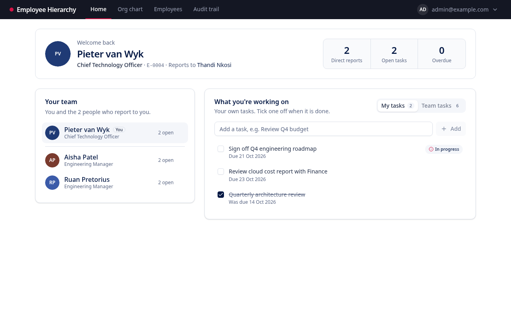
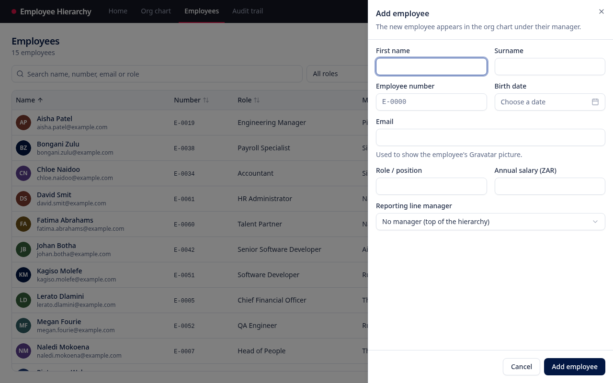
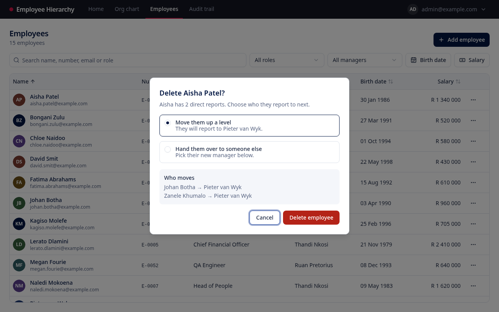

# Brand and style guide

How Employee Hierarchy looks and speaks, so new screens match the existing ones. The tokens below are the real ones in [`apps/web/src/index.css`](../apps/web/src/index.css); change them there, not in components.

## 1. Identity

- **Name:** Employee Hierarchy. Always two words, both capitalised. Not "the Hierarchy app" or "EH".
- **Mark:** a crimson dot before the name, in the header. It is the only logo; there is no image file.
- **Origin of the palette:** taken from the assessment brief's own design: navy `#021743` from its headings and wordmark, crimson `#D41446` from its logo mark, and midnight `#141723` from its banner. The app is meant to feel at home beside EPI-USE material without using EPI-USE's logo.

## 2. Colour

### 2.1 Tokens (light theme)

Names follow [shadcn/ui](https://ui.shadcn.com). Use the Tailwind class (`bg-primary`, `text-muted-foreground`, …), never a hex value in a component.

| Token                 | Hex       | Use                                                       |
| --------------------- | --------- | --------------------------------------------------------- |
| `background`          | `#FFFFFF` | Page and card background                                  |
| `foreground`          | `#1E2A44` | Body text                                                 |
| `heading`             | `#021743` | Headings (`h1`–`h3` get it automatically)                 |
| `primary`             | `#021743` | Primary buttons, selected states, checked boxes           |
| `primary-foreground`  | `#FFFFFF` | Text on primary                                           |
| `secondary` / `muted` | `#F4F6FA` | Secondary buttons, table header, quiet panels             |
| `muted-foreground`    | `#5B6784` | Supporting text: descriptions, emails under names, dates  |
| `accent`              | `#EAEEF6` | Hover backgrounds                                         |
| `border` / `input`    | `#DCE1EA` | Borders and input outlines                                |
| `ring`                | `#3B5BA9` | Keyboard focus ring                                       |
| `destructive`         | `#B42318` | Delete actions and errors only                            |
| `warning`             | `#A15C07` | Warnings: no manager, multiple roots                      |
| `brand`               | `#D41446` | The logo dot and the active navigation tab. Nothing else. |
| `header`              | `#141723` | The top bar                                               |
| `header-foreground`   | `#FFFFFF` | Header text                                               |
| `header-muted`        | `#9AA0B4` | Inactive navigation, the account name                     |

### 2.2 Rules

- **Crimson is the brand, not an action.** It never appears on a button, so nobody confuses it with the red of a delete. Actions use navy; deleting uses `destructive`.
- **Red means "this removes something or went wrong".** Use `destructive` for delete buttons, error text and overdue dates, and nothing else.
- **Amber means "check this".** `warning` marks data that is valid but worth a look, such as an employee with no manager.
- **Colour is never the only signal.** Overdue tasks also say "Overdue"; errors also say what is wrong; the active tab is also brighter and heavier than the others.

### 2.3 Contrast

Measured against WCAG 2.2. AA needs 4.5:1 for text and 3:1 for non-text marks.

| Pair                                               | Ratio  | Result          |
| -------------------------------------------------- | ------ | --------------- |
| Body text on white                                 | 14.3:1 | AAA             |
| Headings / primary on white                        | 17.4:1 | AAA             |
| Muted text on white                                | 5.6:1  | AA              |
| Muted text on muted                                | 5.2:1  | AA              |
| White on primary button                            | 17.4:1 | AAA             |
| Destructive on white, and white on destructive     | 6.6:1  | AA              |
| Warning on white                                   | 5.2:1  | AA              |
| Inactive navigation on header                      | 6.9:1  | AA              |
| Brand on header (dot and active-tab bar, not text) | 3.4:1  | AA for non-text |
| Focus ring on white                                | 6.5:1  | AA for non-text |

### 2.4 Avatar colours

When an employee has no picture, their initials sit on one of eight colours, chosen from their id so each person keeps the same colour everywhere. Every one carries white text at 6.5:1 or better.

`#021743` `#1F3A75` `#3B5BA9` `#2F5D62` `#5B3F8C` `#7A3B2E` `#355E3B` `#6B4E16`

### 2.5 Dark theme

A full set of dark tokens is defined under `.dark` in `index.css`, but nothing switches it on yet. A new colour must be given a dark value as well, so the theme stays complete.

## 3. Typography

- **Typeface:** the system sans-serif stack (Tailwind's default): Segoe UI on Windows, San Francisco on Apple devices, Noto Sans or similar on Linux. No web fonts are loaded, so text renders immediately and the CSP needs no font host.
- **Monospace** for identifiers: employee numbers (`E-0042`) and keyboard hints.
- **Tabular figures** (`tabular-nums`) for anything compared in columns: salaries, counts, dates in the task list.

| Role       | Style                                                  |
| ---------- | ------------------------------------------------------ |
| Page title | `text-xl font-semibold tracking-tight`, heading colour |
| Card title | `font-semibold`, heading colour                        |
| Body       | `text-sm`, foreground                                  |
| Supporting | `text-sm` or `text-xs`, muted-foreground               |
| Labels     | `text-sm font-medium`                                  |

Sentence case everywhere: "Add employee", not "Add Employee".

## 4. Layout and shape

- **Shell:** a dark header across the top with the name, the four sections (Home, Org chart, Employees, Audit trail) and the account menu on the right. The active section has a crimson bar beneath it.
- **Page:** a title with a one-line description or count beneath it, actions top right, content below. Content pages are capped at `max-w-6xl` (home) or `max-w-7xl` (tables) and padded `p-6`; the org chart uses the full width.
- **Spacing:** Tailwind's 4-pixel scale. Gaps of 2–4 within a group, 4–6 between groups.
- **Radius:** `--radius` is 10 px for cards and dialogs; inputs and buttons use 8 px; small chips 6 px.
- **Surfaces:** white cards with a 1 px border and a faint shadow. No heavy shadows or gradients.

## 5. Components

Built from [shadcn/ui](https://ui.shadcn.com) on [Radix](https://www.radix-ui.com), which supplies keyboard handling and screen-reader semantics. Keep to these; do not hand-roll a dialog or menu.

| Component                            | When                                                                             |
| ------------------------------------ | -------------------------------------------------------------------------------- |
| **Button, primary** (navy)           | The one main action on a page or form: "Add employee", "Save changes", "Sign in" |
| **Button, outline**                  | Secondary actions beside it: "Edit", "Add report", "Cancel", filter triggers     |
| **Button, ghost**                    | Low-emphasis or icon-only actions: row menus, close, the bin                     |
| **Button, destructive**              | The confirming delete only: "Delete employee"                                    |
| **Sheet** (slides in from the right) | Forms: adding and editing an employee                                            |
| **Alert dialog**                     | Confirming something permanent: deleting                                         |
| **Popover**                          | Small inline editors: the birth-date and salary ranges, the date picker          |
| **Dropdown menu**                    | Per-row actions (⋯) and the account menu                                         |
| **Select**                           | Choosing one of a known list: role, manager, change type                         |
| **Command palette**                  | Finding a person on the org chart (Ctrl K / ⌘ K)                                 |
| **Toast** (bottom corner)            | The result of an action: "Added Thandi Nkosi", or an error not tied to a field   |
| **Alert**                            | A standing condition on a page: several people with no manager                   |
| **Badge**                            | Small status: "No manager", "In progress", "You"                                 |

## 6. Icons

[Lucide](https://lucide.dev), at the component's default size (16 px in buttons). Pair an icon with a word unless the meaning is universal (close ×, search, bin), and give icon-only buttons an `aria-label` naming the person or thing ("Delete Johan Botha", "Actions for Aisha Patel").

## 7. Writing

The interface talks like a helpful colleague: plain, short, specific.

- **Say what happened, then what to do.** "That email and password do not match an account." / "Aisha Patel has no manager to move their team to. Choose who they report to instead."
- **Name things.** "Deleted Johan Botha", not "Item deleted". "Give Aisha a task", not "Add task for user".
- **Address the user as "you".** "You and the 2 people who report to you."
- **No blame, no jargon.** Not "Invalid input" or "Error 422". Field errors say what is needed: "Use the format E-0000."
- **Security messages stay vague on purpose.** Sign-in never says which of email or password was wrong.
- **Sentence case, no exclamation marks, no full stop on buttons or titles.**

## 8. Formats

| Thing           | Format                                | Example                   |
| --------------- | ------------------------------------- | ------------------------- |
| Money           | South African rand, `en-ZA`, no cents | R 1 340 000               |
| Hidden salary   | The word, in muted text               | Hidden                    |
| Date            | Day, short month, year                | 03 Apr 1990               |
| Date and time   | Date, then 24-hour time               | 20 Oct 2026, 14:05        |
| Employee number | `E-` and four digits, monospace       | E-0042                    |
| Name            | First name then surname               | Thandi Nkosi              |
| Counts          | Number and noun, pluralised           | 1 employee · 15 employees |

Dates are stored and sent as `YYYY-MM-DD` and always read as local dates, so a birthday never shifts by a day across time zones.

## 9. Accessibility checklist for new screens

- Every input has a visible label; every icon-only button has an `aria-label`.
- Everything works by keyboard, and focus is visible (the `ring` colour).
- Text meets the contrast table above; do not introduce a lighter grey.
- Status is never colour alone.
- Dialogs trap focus and close with Escape (Radix does this; do not replace it).
- The browser tests find controls by their accessible names, so a missing label usually fails a test.
