# Diagrams

The system drawn from six angles. Each diagram is [Mermaid](https://mermaid.js.org/), which GitHub renders in place, so the diagrams live beside the code and change with it.

1. [System context](#1-system-context): who and what the system talks to
2. [Deployment](#2-deployment-on-aws): what runs where on AWS
3. [Request path](#3-request-path): how one request is routed
4. [Data model](#4-data-model): the tables and their relationships
5. [Sign-in and session renewal](#5-sign-in-and-session-renewal)
6. [Changing a reporting line](#6-changing-a-reporting-line): the two-layer loop check
7. [Deleting a manager](#7-deleting-a-manager)
8. [Avatar resolution](#8-avatar-resolution)
9. [Delivery pipeline](#9-delivery-pipeline)
10. [Test layers](#10-test-layers)
11. [A login's life](#11-a-logins-life)

## 1. System context

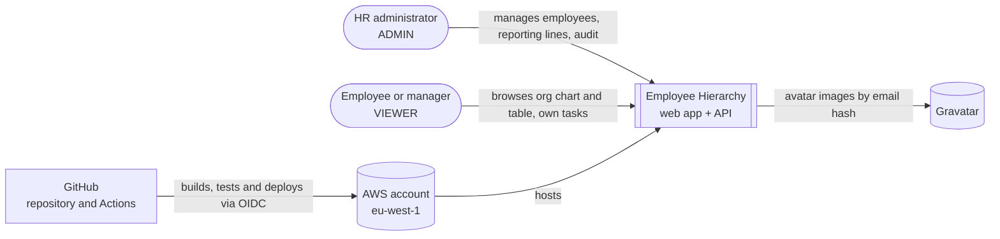

## 2. Deployment on AWS

Everything regional is in eu-west-1 ([ADR-0024](adr/0024-deploy-to-eu-west-1.md)); CloudFront is global. All of it is defined in [`infra/`](../infra) ([ADR-0018](adr/0018-terraform-for-infrastructure.md)).

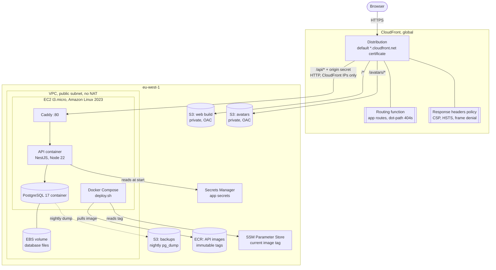

## 3. Request path

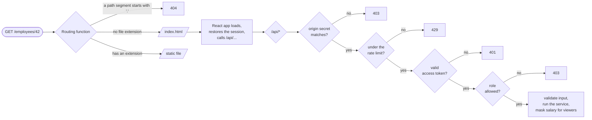

## 4. Data model

Dotted lines are relationships with no foreign key: the audit trail must outlive the employees and users it mentions. The authoritative definition is [`apps/api/prisma/schema.prisma`](../apps/api/prisma/schema.prisma) and its migrations. Database triggers fill `employee_audit` and refuse reporting loops ([ADR-0008](adr/0008-defence-in-depth-cycle-prevention.md), [ADR-0011](adr/0011-audit-trail-via-database-triggers.md)).

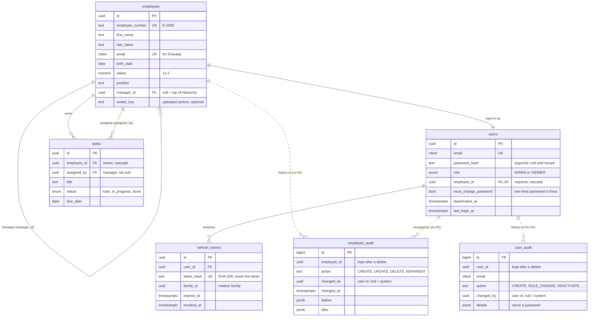

## 5. Sign-in and session renewal

The access token lives only in memory; the refresh token is an httpOnly cookie scoped to `/api/auth`, rotated on every use ([ADR-0014](adr/0014-self-hosted-jwt-auth-and-salary-masking.md), [ADR-0030](adr/0030-web-session-renewal.md)).

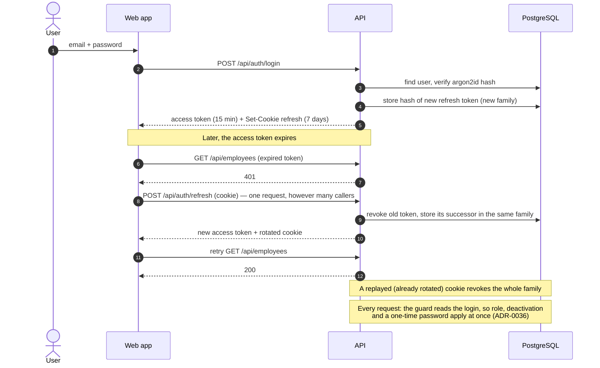

## 6. Changing a reporting line

Two layers refuse a loop: the service explains it, the trigger guarantees it ([ADR-0008](adr/0008-defence-in-depth-cycle-prevention.md)).

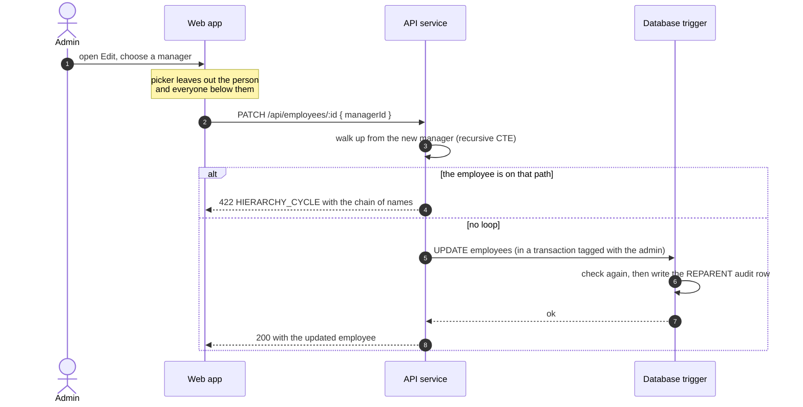

## 7. Deleting a manager

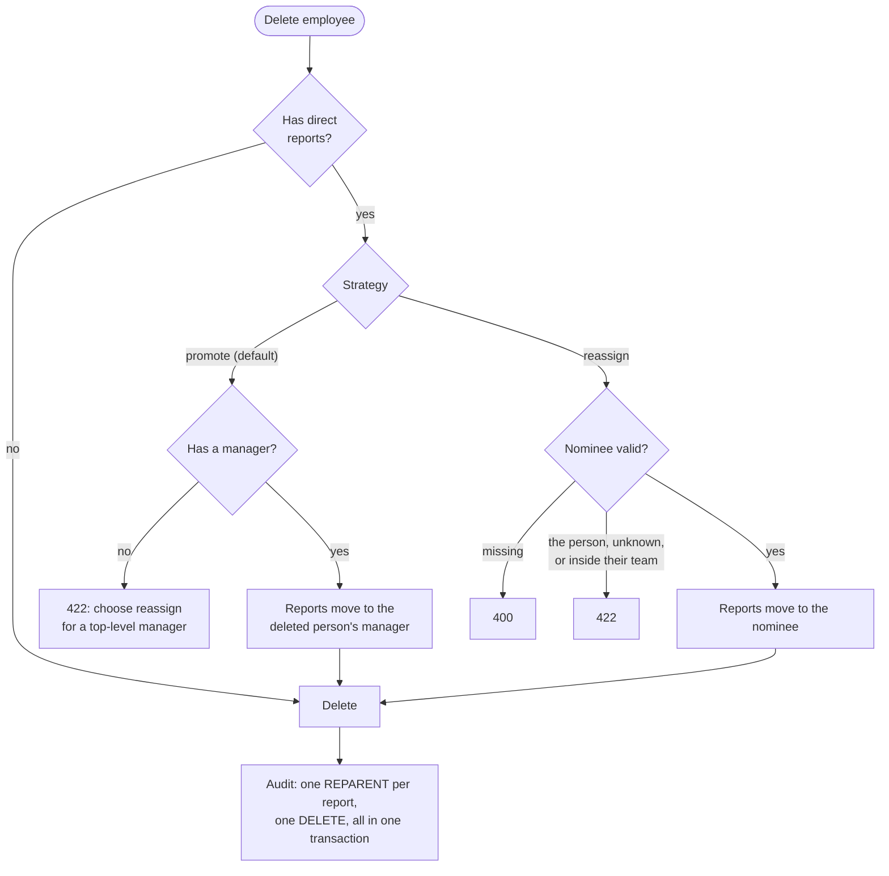

## 8. Avatar resolution

Resolved on the server, so every screen shows the same picture ([ADR-0013](adr/0013-avatar-resolution-chain.md)).

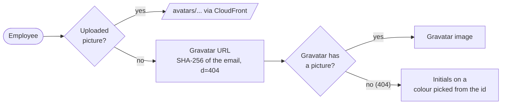

## 9. Delivery pipeline

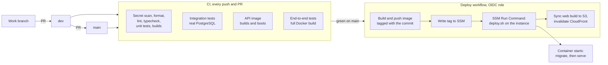

## 10. Test layers

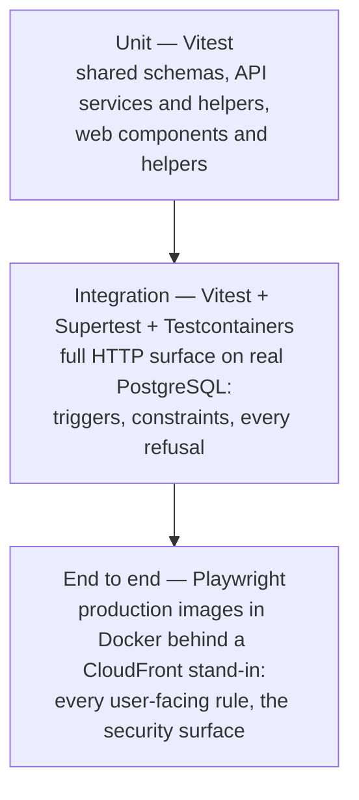

See [ADR-0020](adr/0020-test-database-triggers-with-testcontainers.md) and [ADR-0035](adr/0035-end-to-end-tests-on-a-full-docker-build.md).

## 11. A login's life

Every employee has one login ([ADR-0036](adr/0036-every-employee-has-a-login-managed-by-admins.md)). The admin moves it between states; the person moves it only by choosing their own password. Every transition is written to `user_audit`.

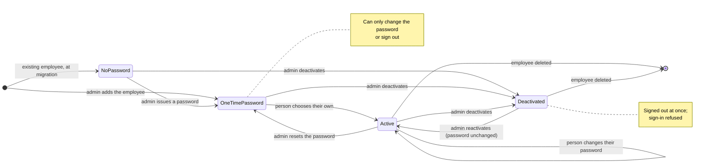

Role is separate from these states: an admin can make any login an admin or a regular user, except their own, and never the last active admin.
