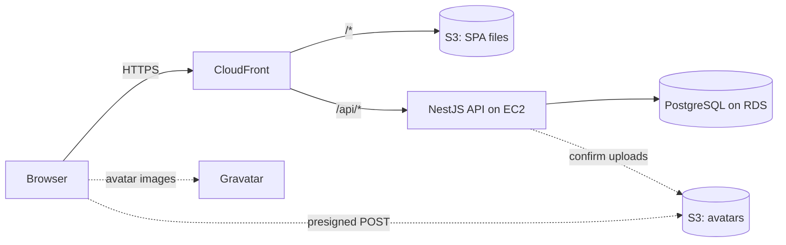

# Employee Hierarchy: technical document

A cloud-hosted application for managing EPI-USE Africa's employee hierarchy: create, read, update and delete employees, set each person's reporting line manager, view the organisation as a tree, search it, and sort and filter a table on any field. Profile pictures come from Gravatar.

This document explains the architecture, the design patterns and technologies used, and why. Each decision is recorded in full, with the alternatives rejected, in the [architecture decision records](adr/README.md); this summary links to them rather than repeating them ([ADR-0001](adr/0001-record-architecture-decisions.md)). Where the build differs from a record, [ADR-0023](adr/0023-record-implementation-deviations.md) says how and why.

## 1. Architecture

Two independently deployed applications share one TypeScript monorepo ([ADR-0002](adr/0002-separate-api-and-web-deployables.md), [ADR-0003](adr/0003-typescript-monorepo-with-shared-schemas.md)):

| Part              | What it is                                                                              |
| ----------------- | --------------------------------------------------------------------------------------- |
| `apps/web`        | React single-page application, built to static files                                    |
| `apps/api`        | NestJS HTTP API in a Docker container                                                   |
| `packages/shared` | zod schemas for every request and response, used by both apps                           |
| PostgreSQL        | The system of record, accessed through Prisma; triggers enforce the hierarchy and audit |

One CloudFront distribution serves both apps, so the browser sees a single origin: there is no CORS configuration anywhere, and the refresh cookie is same-site ([ADR-0016](adr/0016-single-cloudfront-distribution-dual-origin.md)). In development, Vite proxies `/api` to the local API, so the client code is identical in both environments.

The deployment target is AWS: EC2 for the API container, RDS for PostgreSQL, S3 and CloudFront for the SPA, all defined in Terraform and deployed from GitHub Actions without stored AWS keys ([ADR-0015](adr/0015-ec2-docker-for-api-compute.md) to [ADR-0019](adr/0019-github-actions-oidc-cicd.md)). The cost model and teardown commitment are in [ADR-0021](adr/0021-credit-funded-run-rate-and-teardown.md).

### What happens on a request

Every API route goes through the same NestJS pipeline ([ADR-0004](adr/0004-nestjs-for-the-api.md)):

1. **Access-token guard.** The route needs a valid Bearer token unless it is marked public ([jwt-auth.guard.ts](../apps/api/src/common/guards/jwt-auth.guard.ts)).
2. **Roles guard.** Writes and the audit trail are `ADMIN`-only ([roles.guard.ts](../apps/api/src/common/guards/roles.guard.ts)).
3. **Validation pipe.** The body, query and path parameters are parsed with the shared zod schema ([zod-validation.pipe.ts](../apps/api/src/common/pipes/zod-validation.pipe.ts)).
4. **Controller → service → Prisma.** Every employee write runs in an audited transaction that records who made it ([prisma.service.ts](../apps/api/src/prisma/prisma.service.ts)).
5. **Salary-masking interceptor.** It removes every salary from the response for a `VIEWER` ([salary-mask.interceptor.ts](../apps/api/src/common/interceptors/salary-mask.interceptor.ts)).
6. **Exception filter.** Any failure is returned as `{ code, message, details }` ([api-exception.filter.ts](../apps/api/src/common/filters/api-exception.filter.ts)).

The API is documented with Swagger at `/api/docs`. The schemas there are generated from the same zod schemas the API validates with, so the documentation cannot drift from what the API accepts.

## 2. The data model

| Table            | Purpose                                                                                                  |
| ---------------- | -------------------------------------------------------------------------------------------------------- |
| `employees`      | The brief's fields, plus email for Gravatar, an uploaded avatar key, and `manager_id` (a self-reference) |
| `users`          | Logins, separate from employees, each optionally linked to one employee                                  |
| `refresh_tokens` | Hashed, rotating refresh tokens grouped into families                                                    |
| `employee_audit` | Before and after images of every employee change, written only by a database trigger                     |
| `tasks`          | Home-screen work items (an additional feature)                                                           |

The schema is in [schema.prisma](../apps/api/prisma/schema.prisma). The constraints and triggers Prisma cannot express are hand-written SQL in [the initial migration](../apps/api/prisma/migrations/20261017000000_init/migration.sql).

**Why an adjacency list.** Each employee stores only their manager's id ([ADR-0007](adr/0007-adjacency-list-for-the-hierarchy.md)). Moving someone is a single-row update, and PostgreSQL's recursive queries (`WITH RECURSIVE`) walk any depth in one round trip. Alternatives such as nested sets or closure tables make reads cheaper but turn every re-parent into a multi-row rewrite, which is the wrong trade for an organisation that reorganises.

**Email is required.** The brief asks for Gravatar, which identifies a picture by a hash of an email address, but its field list has no email. Email is therefore a required field, and the deviation is recorded rather than hidden ([ADR-0012](adr/0012-require-email-on-employee-record.md)).

## 3. How the brief's rules are enforced

**"Employees may not be their own manager."** Self-management is only the simplest loop. A → B → C → A is equally invalid, and a single-column `CHECK` constraint cannot detect it. The rule is enforced at two layers, each with a different job ([ADR-0008](adr/0008-defence-in-depth-cycle-prevention.md)):

- **The database guarantees it.** A trigger walks the proposed manager's chain upward and refuses the write if the employee is on it. This applies to every writer, including direct SQL. A `CHECK (manager_id <> id)` constraint covers the self-managing case even more cheaply.
- **The API explains it.** Before writing, the service runs the same walk and answers `422` with the loop named, for example _"That change would create a reporting loop: Ann Top → Cas Low → Ben Mid → Ann Top"_. The manager picker in the UI also leaves out the employee and everyone below them.

**"An employee may have no manager."** `manager_id` is nullable. More than one top-level person is allowed but flagged in the org chart as a data-quality warning, since it is usually a mistake but sometimes legitimate, such as a contractor ([ADR-0009](adr/0009-permit-multiple-hierarchy-roots.md)).

**Deleting a manager.** The database refuses to delete someone who still has reports (`ON DELETE RESTRICT`), so the API makes the choice explicit ([ADR-0010](adr/0010-explicit-deletion-strategies.md)):

- **Promote** moves the team up to the deleted person's manager.
- **Reassign** hands the team to a named person outside the departing manager's own subtree.

The move and the delete happen in one transaction. The UI shows who will move where before the user confirms.

**"No mocked data."** Every screen reads from and writes to PostgreSQL through the API. The seed script inserts a starter organisation into the database; it is ordinary data, not fixtures in the application.

## 4. Security

The brief does not require authentication, but a public URL in front of every employee's salary and birth date needs it ([ADR-0014](adr/0014-self-hosted-jwt-auth-and-salary-masking.md)):

- Passwords are hashed with **argon2id**.
- A **15-minute access token** is held only in memory, never in browser storage, so a script injected into the page cannot steal a long-lived credential.
- A **refresh token** lives in an `httpOnly` cookie scoped to `/api/auth`. It is stored only as a hash, replaced on every use, and replaying an old one ends the whole session. On page load the web app swaps the cookie for a new access token, so a reload keeps the user signed in.
- Two roles: **ADMIN** has full access. **VIEWER** is read-only and never receives salaries. The API removes them from every response, and refuses to sort or filter by salary, because the order alone would reveal the hidden values.
- In production, requests that do not carry CloudFront's shared origin header are refused, so the API cannot be reached by going around the CDN.
- A pre-commit hook and CI scan for committed secrets. Real secrets live in AWS Secrets Manager and are read at startup ([ADR-0018](adr/0018-terraform-for-infrastructure.md)).

## 5. Design patterns

| Pattern                  | Where                                                                                                                                                  |
| ------------------------ | ------------------------------------------------------------------------------------------------------------------------------------------------------ |
| Layered architecture     | Controller → service → repository in every API module ([ADR-0004](adr/0004-nestjs-for-the-api.md))                                                     |
| Dependency injection     | The NestJS container wires services and lets tests substitute fakes, e.g. an in-memory refresh-token store                                             |
| Strategy                 | [Promote and reassign](../apps/api/src/employees/delete-strategies/) when deleting a manager ([ADR-0010](adr/0010-explicit-deletion-strategies.md))    |
| Chain of Responsibility  | [Avatar resolution](../apps/api/src/avatars/avatar.service.ts): uploaded image → Gravatar → initials ([ADR-0013](adr/0013-avatar-resolution-chain.md)) |
| Observer                 | The audit trigger reacts to every employee change, whoever makes it ([ADR-0011](adr/0011-audit-trail-via-database-triggers.md))                        |
| Decorator                | Guards, the salary interceptor, and the `@Roles()`, `@Public()` and `@CurrentUser()` decorators                                                        |
| Repository / Data Mapper | Prisma for persistence; [EmployeeMapper](../apps/api/src/employees/employee.mapper.ts) turns rows into the shared response shapes                      |
| Composite                | The org chart treats every node, from the CEO to an individual contributor, the same way ([ADR-0007](adr/0007-adjacency-list-for-the-hierarchy.md))    |
| Single source of truth   | One set of zod schemas validates the browser form and the API request ([ADR-0003](adr/0003-typescript-monorepo-with-shared-schemas.md))                |

## 6. Technologies, and why

| Technology                               | Used for                     | Why                                                                                                                                                                               |
| ---------------------------------------- | ---------------------------- | --------------------------------------------------------------------------------------------------------------------------------------------------------------------------------- |
| TypeScript throughout                    | Both apps and shared code    | One language and one type system across the stack; a contract change breaks the build on both sides instead of at runtime                                                         |
| pnpm workspaces                          | Monorepo                     | One install and one CI run for both apps; the shared package is built once and used by both                                                                                       |
| NestJS                                   | API                          | Built-in dependency injection and named places for guards, pipes, interceptors and filters keep the cross-cutting rules out of the business logic                                 |
| PostgreSQL + Prisma 7                    | Data                         | Recursive queries for the hierarchy, triggers for invariants every writer must obey, and typed queries with reviewable migrations ([ADR-0006](adr/0006-postgresql-via-prisma.md)) |
| zod                                      | Validation                   | Schemas that are both the runtime check and the TypeScript type, shared by browser and server                                                                                     |
| React + Vite                             | Web client                   | A fast static build suited to an authenticated internal tool with no search-engine needs ([ADR-0005](adr/0005-react-vite-spa-for-the-web-client.md))                              |
| React Flow + d3-hierarchy                | Org chart                    | React Flow handles panning, zooming and hit testing; d3's tidy-tree algorithm handles the layout                                                                                  |
| TanStack Query and Table                 | Server data, reporting table | Caching with invalidation after every change, so the chart, table and home screen stay in step                                                                                    |
| Tailwind + shadcn/ui                     | Interface                    | Accessible components themed with the colours from the assessment brief                                                                                                           |
| Vitest, Testcontainers, Playwright       | Testing                      | Unit tests for logic; integration tests against a real PostgreSQL; a browser test for the main journey ([ADR-0020](adr/0020-test-database-triggers-with-testcontainers.md))       |
| Docker, Terraform, GitHub Actions on AWS | Delivery                     | Reproducible infrastructure and deploys without stored cloud credentials ([ADR-0015](adr/0015-ec2-docker-for-api-compute.md)–[ADR-0019](adr/0019-github-actions-oidc-cicd.md))    |

## 7. Testing

| Layer       | Count | What it covers                                                                                                                                                                                                       |
| ----------- | ----- | -------------------------------------------------------------------------------------------------------------------------------------------------------------------------------------------------------------------- |
| Unit        | 44    | Loop naming, both delete strategies, the sort and filter allowlist including the salary rule, Gravatar hashing, salary masking, refresh-token rotation and reuse, audit summaries, task ordering, the shared schemas |
| Integration | 24    | A real PostgreSQL per suite, migrated as in production. Raw SQL that bypasses the API proves the database itself refuses loops and audits every write; HTTP tests cover each endpoint's behaviour and errors         |
| End to end  | 1     | Login → create → re-parent → search → delete → check the audit trail. Written but not yet enabled                                                                                                                    |

GitHub Actions runs a secret scan, formatting, lint, type checks, unit tests, integration tests and both builds on every push and pull request.

## 8. Additional features

Beyond the brief, documented so they can be credited:

- **Authentication and roles**, with salaries hidden from viewers (§4).
- **Audit trail.** Every change to an employee, with who made it, when, and a readable summary, kept even after the employee is deleted ([ADR-0011](adr/0011-audit-trail-via-database-triggers.md)).
- **Safe deletion of managers** with a preview of who moves where (§3).
- **Named reporting loops** instead of a generic error (§3).
- **Personal home screen.** The signed-in person, their manager, their team, and a task list that can switch to show the whole team's tasks ([ADR-0022](adr/0022-home-screen-tasks-and-user-employee-link.md)).
- **Avatar uploads** on the API side, with S3 enforcing type and size. The upload screen is still to come.
- **Search anywhere** in the org chart with Ctrl+K, centring the chart on the person found.

## 9. Known compromises

Recorded so they are found rather than discovered:

- The API runs on a single instance in one availability zone, with no failover ([ADR-0015](adr/0015-ec2-docker-for-api-compute.md)).
- Traffic between CloudFront and the API is unencrypted HTTP inside AWS, mitigated by the origin header and an IP allow-list ([ADR-0016](adr/0016-single-cloudfront-distribution-dual-origin.md)).
- Authentication is hand-rolled, with no MFA, password reset or lockout ([ADR-0014](adr/0014-self-hosted-jwt-auth-and-salary-masking.md)).
- Deletion is permanent. The audit trail keeps the record of it but cannot restore it ([ADR-0010](adr/0010-explicit-deletion-strategies.md)).
- Still to build: the AWS infrastructure and deploy workflow, the avatar upload screen, drag-to-re-parent and collapse in the org chart, CSV import, and enabling the end-to-end test. The full list is in [ADR-0023](adr/0023-record-implementation-deviations.md).
