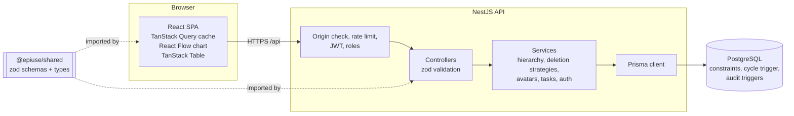
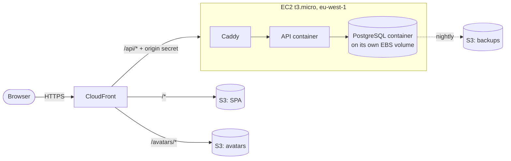

# Technical document

The architecture of Employee Hierarchy, the design patterns it uses, the technologies chosen, and why. It is a summary: each decision is argued in full, with the alternatives rejected, in the [architecture decision records](adr/README.md) (ADRs) linked throughout.

**Live:** https://d1qxvq2ahpxf8h.cloudfront.net · **Requirements:** [SRS](srs.md) · **Diagrams:** [diagrams.md](diagrams.md) · **Using it:** [user guide](user-guide.md)

## 1. The problem, and the shape of the answer

EPI-USE Africa needs a cloud-hosted system to manage its employees and reporting lines: CRUD on employee records, a reporting-line manager per employee that can never form a loop, a visual hierarchy, search, a sortable and filterable table, Gravatar pictures, and every change stored in a real database ([brief](Technical%20Services%20-%20Assessment%20v2.1.pdf)).

The answer is three parts:

- a **single-page web app** (React) that does all presentation;
- a **JSON API** (NestJS) that owns every rule;
- **PostgreSQL**, which also enforces the two rules that matter most, so they hold even if the API is bypassed.

Both apps are TypeScript in one repository and share their validation schemas.

## 2. Architecture

### 2.1 Components

| Part           | Responsibility                                                                                              | Where                                   |
| -------------- | ----------------------------------------------------------------------------------------------------------- | --------------------------------------- |
| Web app        | Screens, client-side sorting and filtering, the org chart layout, session renewal                           | [`apps/web`](../apps/web)               |
| API            | Authentication, authorisation, validation, the hierarchy and deletion rules, salary masking, avatars, tasks | [`apps/api`](../apps/api)               |
| Shared schemas | Every request and response shape, defined once in zod and used by both ends                                 | [`packages/shared`](../packages/shared) |
| Database       | Uniqueness, the no-self-management `CHECK`, the cycle trigger, the audit triggers                           | [`apps/api/prisma`](../apps/api/prisma) |
| Infrastructure | Everything on AWS, as Terraform                                                                             | [`infra`](../infra)                     |
| Runtime        | PostgreSQL, the API and Caddy on the server, as Compose                                                     | [`deploy`](../deploy)                   |

The API and the web app are separate deployables ([ADR-0002](adr/0002-separate-api-and-web-deployables.md)): the SPA is static files, the API is a container, and they scale and fail independently.

### 2.2 Deployment

- **One CloudFront distribution serves everything** ([ADR-0016](adr/0016-single-cloudfront-distribution-dual-origin.md)). The SPA and the API share an origin, so there is no CORS and the refresh cookie is same-site. CloudFront provides TLS with no domain to buy.
- **The API and PostgreSQL run as containers on one t3.micro** ([ADR-0015](adr/0015-ec2-docker-for-api-compute.md), [ADR-0023](adr/0023-postgresql-container-on-the-api-instance.md)). The database files live on their own EBS volume, which outlives the instance, and are dumped to S3 nightly.
- **The instance accepts traffic only from CloudFront**, by security group and by a secret header checked in the API ([ADR-0016](adr/0016-single-cloudfront-distribution-dual-origin.md), [ADR-0025](adr/0025-rate-limit-by-client-address.md)). It sits in a public subnet with no NAT gateway and is administered through SSM, with no SSH ([ADR-0017](adr/0017-omit-nat-gateway-use-ssm.md)).
- **Region eu-west-1** for price and maturity; the static half is served from CloudFront's South African edge ([ADR-0024](adr/0024-deploy-to-eu-west-1.md)).

The full picture, with every AWS service, is [diagram 2](diagrams.md#2-deployment-on-aws).

### 2.3 Data

Six tables ([diagram 4](diagrams.md#4-data-model)):

- **`employees`**, with `manager_id` pointing at another employee: an adjacency list ([ADR-0007](adr/0007-adjacency-list-for-the-hierarchy.md)). Subtrees and ancestor chains are read with recursive CTEs.
- **`users`**: logins. Every employee has exactly one, created and deleted with them ([ADR-0036](adr/0036-every-employee-has-a-login-managed-by-admins.md)).
- **`user_audit`**, every change to a login, written only by a trigger like `employee_audit`.
- **`refresh_tokens`**, hashed, grouped into rotation families.
- **`employee_audit`**, written only by triggers ([ADR-0011](adr/0011-audit-trail-via-database-triggers.md)).
- **`tasks`**, owned by an employee and optionally assigned by their manager ([ADR-0032](adr/0032-managers-assign-tasks-to-direct-reports.md)).

The brief's minimum fields are all present. **Email is added and required**, because Gravatar is addressed only by email; this is a deliberate deviation from the brief's list, explained in [ADR-0012](adr/0012-require-email-on-employee-record.md).

### 2.4 The two rules the database guarantees

**No reporting loops** ([ADR-0008](adr/0008-defence-in-depth-cycle-prevention.md)). "May not be their own manager" is the one-person case of a loop; A→B→C→A is equally invalid, and a `CHECK` constraint cannot see it. So the rule is enforced three times:

1. the web app's manager picker never offers the person or anyone below them;
2. the API walks up from the proposed manager and refuses with the chain of names (`422 HIERARCHY_CYCLE`);
3. a PL/pgSQL trigger repeats the check inside the transaction, so a race or a write that bypasses the API still fails.

A person with no manager is valid. More than one is allowed and shown as a warning ([ADR-0009](adr/0009-permit-multiple-hierarchy-roots.md)). See [diagram 6](diagrams.md#6-changing-a-reporting-line).

**Every change is audited** ([ADR-0011](adr/0011-audit-trail-via-database-triggers.md)). Triggers on `employees` write the before and after of every insert, update and delete. The API tags each transaction with the acting user in a session variable, so the trigger records who did it. A write from outside the API is still recorded, attributed to the system.

### 2.5 Security

| Concern        | Measure                                                                                                                                                                               | Record                                                                                                       |
| -------------- | ------------------------------------------------------------------------------------------------------------------------------------------------------------------------------------- | ------------------------------------------------------------------------------------------------------------ |
| Sign-in        | argon2id password hashes; the same answer for an unknown email and a wrong password                                                                                                   | [ADR-0014](adr/0014-self-hosted-jwt-auth-and-salary-masking.md)                                              |
| Sessions       | 15-minute access token held in memory; 7-day refresh token in an httpOnly, Secure, SameSite cookie scoped to `/api/auth`, rotated on every use, with replay revoking the whole family | [ADR-0014](adr/0014-self-hosted-jwt-auth-and-salary-masking.md), [ADR-0030](adr/0030-web-session-renewal.md) |
| Authorisation  | Global JWT guard that reads the login on every request, so role changes and deactivations apply at once; `@Roles('ADMIN')` on every write, the audit trail and user management        | [ADR-0014](adr/0014-self-hosted-jwt-auth-and-salary-masking.md)                                              |
| Salary privacy | An interceptor nulls salaries for viewers; sorting or filtering by salary is refused for them, because order alone would leak it                                                      | [ADR-0014](adr/0014-self-hosted-jwt-auth-and-salary-masking.md)                                              |
| Abuse          | Every route rate-limited per viewer address; sign-in limited to 10 tries per 15 minutes                                                                                               | [ADR-0025](adr/0025-rate-limit-by-client-address.md)                                                         |
| Origin         | Security group admits only CloudFront; the API requires CloudFront's secret header in production                                                                                      | [ADR-0016](adr/0016-single-cloudfront-distribution-dual-origin.md)                                           |
| Browser        | Strict CSP (scripts from the site only, no eval, no framing), HSTS, no source maps, dotfile probes answered 404                                                                       | [ADR-0034](adr/0034-harden-the-public-web-surface.md)                                                        |
| Surface        | API docs not served in production                                                                                                                                                     | [ADR-0033](adr/0033-keep-api-docs-off-the-public-deployment.md)                                              |
| Secrets        | None in the repository: Secrets Manager at runtime; GitHub deploys through OIDC with no stored AWS keys; secret scanning in CI and a pre-commit hook                                  | [ADR-0018](adr/0018-terraform-for-infrastructure.md), [ADR-0019](adr/0019-github-actions-oidc-cicd.md)       |

### 2.6 Delivery

Work goes through pull requests into `dev`, then into `main`. CI runs on every push and pull request: secret scan, formatting, lint, typecheck, unit tests, both builds, integration tests on real PostgreSQL, a boot test of the production image, and the end-to-end suite on a full Docker build. When CI passes on `main`, the deploy workflow assumes an AWS role through GitHub's OIDC token and:

1. builds the API image, tagged with the commit;
2. records the tag in SSM;
3. runs the deploy script on the instance through SSM, which pulls the image and restarts the API; the API applies pending migrations as it starts ([ADR-0026](adr/0026-self-migrating-api-image-released-by-tag.md));
4. publishes the SPA to S3 and invalidates CloudFront.

See [diagram 9](diagrams.md#9-delivery-pipeline).

## 3. Design patterns

Each pattern is applied to a specific problem, not for its own sake.

| Pattern                        | Applied to                                                                                                                                | Where                                                                                                                              |
| ------------------------------ | ----------------------------------------------------------------------------------------------------------------------------------------- | ---------------------------------------------------------------------------------------------------------------------------------- |
| **Strategy**                   | What happens to a deleted manager's team: `promote` (to their manager) or `reassign` (to a nominee), chosen per request                   | [`employees/delete-strategies`](../apps/api/src/employees/delete-strategies), [ADR-0010](adr/0010-explicit-deletion-strategies.md) |
| **Chain of Responsibility**    | Choosing an avatar: uploaded picture, else Gravatar, else initials                                                                        | [`avatars/avatar.service.ts`](../apps/api/src/avatars/avatar.service.ts), [ADR-0013](adr/0013-avatar-resolution-chain.md)          |
| **Observer**                   | The audit trail: database triggers observe every change to `employees`                                                                    | init migration, [ADR-0011](adr/0011-audit-trail-via-database-triggers.md)                                                          |
| **Composite**                  | The org chart: each node is an employee whose children are their reports, laid out as one tree (several roots hang off one hidden parent) | [`hierarchy/layout.ts`](../apps/web/src/features/hierarchy/layout.ts), [ADR-0007](adr/0007-adjacency-list-for-the-hierarchy.md)    |
| **Repository and Data Mapper** | Prisma for persistence; mappers turn rows into API shapes (dates, decimals, avatar URLs)                                                  | [`employee.mapper.ts`](../apps/api/src/employees/employee.mapper.ts), [ADR-0006](adr/0006-postgresql-via-prisma.md)                |
| **Dependency Injection**       | NestJS wires every service; tests inject fakes                                                                                            | throughout, [ADR-0004](adr/0004-nestjs-for-the-api.md)                                                                             |
| **Decorator**                  | `@Roles()`, `@Public()`, `@CurrentUser()`, `@Throttle()`; the salary-masking interceptor                                                  | [`common/`](../apps/api/src/common), [ADR-0004](adr/0004-nestjs-for-the-api.md)                                                    |
| **Layered architecture**       | Controller (HTTP and validation) → Service (rules) → Prisma (data)                                                                        | each API module                                                                                                                    |
| **Single source of truth**     | One zod schema per shape, validating on both ends and generating the types and API docs                                                   | [`packages/shared`](../packages/shared), [ADR-0003](adr/0003-typescript-monorepo-with-shared-schemas.md)                           |

## 4. Technologies, and why

| Area           | Choice                                                      | Why this, here                                                                                                                                                                                                                                                                        |
| -------------- | ----------------------------------------------------------- | ------------------------------------------------------------------------------------------------------------------------------------------------------------------------------------------------------------------------------------------------------------------------------------- |
| Language       | **TypeScript** everywhere                                   | One language across API, web and shared schemas, so a field renamed in one place fails to compile everywhere it is used ([ADR-0003](adr/0003-typescript-monorepo-with-shared-schemas.md)).                                                                                            |
| Monorepo       | **pnpm workspaces**                                         | The shared package is a workspace dependency; one lockfile, one CI.                                                                                                                                                                                                                   |
| Validation     | **zod 4**                                                   | Runs in the browser and on the server from the same definition; produces precise, field-level errors.                                                                                                                                                                                 |
| API            | **NestJS 12** on Node 22                                    | Guards, interceptors, pipes and filters give each cross-cutting concern (auth, roles, masking, validation, error shape) a named, testable home; dependency injection keeps services unit-testable ([ADR-0004](adr/0004-nestjs-for-the-api.md)).                                       |
| Database       | **PostgreSQL 17**                                           | Recursive CTEs for the hierarchy, triggers for loop prevention and audit, `citext` for case-insensitive unique emails ([ADR-0006](adr/0006-postgresql-via-prisma.md)).                                                                                                                |
| Data access    | **Prisma 7**                                                | Type-safe queries and versioned SQL migrations, with raw SQL where the hierarchy needs it.                                                                                                                                                                                            |
| Auth           | Self-hosted **JWT + rotating refresh tokens**, **argon2id** | Two roles and a handful of users do not justify a managed identity service; the implementation is small and fully tested ([ADR-0014](adr/0014-self-hosted-jwt-auth-and-salary-masking.md)).                                                                                           |
| Web            | **React 19 + Vite 8**, SPA                                  | A static bundle on S3 and CloudFront: no server to run for the UI ([ADR-0005](adr/0005-react-vite-spa-for-the-web-client.md)).                                                                                                                                                        |
| Server state   | **TanStack Query**                                          | One cached copy of the organisation shared by every screen, refreshed after each change ([ADR-0031](adr/0031-load-the-whole-organisation-into-the-client.md)).                                                                                                                        |
| Table          | **TanStack Table**                                          | Sorting and filtering on every column, in the browser, instantly.                                                                                                                                                                                                                     |
| Chart          | **React Flow + d3-hierarchy**                               | Pan, zoom and minimap from React Flow; a tidy tree layout from d3.                                                                                                                                                                                                                    |
| Forms          | **react-hook-form** with the shared zod schemas             | The form refuses exactly what the API would.                                                                                                                                                                                                                                          |
| UI kit         | **shadcn/ui** on **Radix**, **Tailwind CSS 4**              | Accessible primitives (dialogs, menus, selects) styled with the project's own tokens ([brand guide](brand-and-style-guide.md)).                                                                                                                                                       |
| Hosting        | **AWS**: CloudFront, S3, EC2, ECR, SSM, Secrets Manager     | Fits within the account's credits at about $13 a month ([ADR-0021](adr/0021-credit-funded-run-rate-and-teardown.md), [ADR-0023](adr/0023-postgresql-container-on-the-api-instance.md)).                                                                                               |
| Infrastructure | **Terraform**                                               | Every resource reviewed as code and removable with one command ([ADR-0018](adr/0018-terraform-for-infrastructure.md)).                                                                                                                                                                |
| CI/CD          | **GitHub Actions** with OIDC                                | No long-lived AWS keys anywhere ([ADR-0019](adr/0019-github-actions-oidc-cicd.md), [ADR-0029](adr/0029-trust-githubs-immutable-oidc-subject.md)).                                                                                                                                     |
| Tests          | **Vitest**, **Testcontainers**, **Playwright**              | Unit tests in milliseconds; integration tests against real PostgreSQL, so the triggers are tested; browser tests against the production images ([ADR-0020](adr/0020-test-database-triggers-with-testcontainers.md), [ADR-0035](adr/0035-end-to-end-tests-on-a-full-docker-build.md)). |

## 5. Why this was the best way to build it

- **Correctness lives where it cannot be skipped.** The loop rule and the audit trail are in the database, so they hold for every writer, now and later. The API and UI add explanation and convenience on top, not the guarantee.
- **One definition of every shape.** Shared schemas mean the form, the API, the types and the API docs cannot disagree.
- **Production-shaped from the start.** The same container image runs in CI, in the end-to-end tests and on AWS; the same Terraform creates the environment; secrets never touch the repository.
- **Cheap, and honest about it.** A single small instance with the database beside it keeps the run rate within the credits. What that trades away is written down, not hidden (below).
- **Tested at the right depth.** Triggers and constraints are tested against real PostgreSQL; user-facing rules are tested in a real browser against the production images.

## 6. Beyond the brief

Built in addition to the requirements, as the brief invites:

- **Sign-in with two roles**, admin and read-only regular user, with salaries hidden from regular users ([ADR-0014](adr/0014-self-hosted-jwt-auth-and-salary-masking.md)).
- **Account management**: every employee gets a login with a one-time password; admins promote, demote, deactivate and reset, audited ([ADR-0036](adr/0036-every-employee-has-a-login-managed-by-admins.md)).
- **Audit trail** of every change, with who made it and each field's old and new value ([ADR-0011](adr/0011-audit-trail-via-database-triggers.md)).
- **Home page with tasks**, where managers can assign tasks to their direct reports ([ADR-0022](adr/0022-home-screen-tasks-and-user-employee-link.md), [ADR-0032](adr/0032-managers-assign-tasks-to-direct-reports.md)).
- **Explicit deletion strategies** that never orphan a team ([ADR-0010](adr/0010-explicit-deletion-strategies.md)).
- **Picture upload** (the optional nice-to-have): admins upload from the edit form straight to S3 with a presigned POST, and pictures are served through CloudFront ([ADR-0013](adr/0013-avatar-resolution-chain.md)).
- **Rate limiting**, a strict CSP and other hardening ([ADR-0025](adr/0025-rate-limit-by-client-address.md), [ADR-0034](adr/0034-harden-the-public-web-surface.md)).
- **Continuous deployment** from `main`, with no stored cloud keys ([ADR-0019](adr/0019-github-actions-oidc-cicd.md)).

## 7. Known compromises

- **One instance, one availability zone.** No autoscaling or failover ([ADR-0015](adr/0015-ec2-docker-for-api-compute.md)).
- **Self-managed database** on that instance, backed up nightly: up to a day of writes could be lost, and recovery is manual ([ADR-0023](adr/0023-postgresql-container-on-the-api-instance.md)).
- **CloudFront to the instance is plain HTTP** inside AWS's network ([ADR-0016](adr/0016-single-cloudfront-distribution-dual-origin.md)).
- **No MFA, self-service password reset or per-account lockout**, and one-time passwords are handed over by the admin, with no email delivery ([ADR-0014](adr/0014-self-hosted-jwt-auth-and-salary-masking.md), [ADR-0036](adr/0036-every-employee-has-a-login-managed-by-admins.md)).
- **Migrations run as the new image starts**, with no separate approval step ([ADR-0026](adr/0026-self-migrating-api-image-released-by-tag.md)).
- **The whole organisation is loaded into the browser**: fine for thousands of employees, not tens of thousands ([ADR-0031](adr/0031-load-the-whole-organisation-into-the-client.md)).
- **Deletion is permanent**; the audit trail records it but does not undo it ([ADR-0010](adr/0010-explicit-deletion-strategies.md)).
- **Credit-funded**, and to be removed with `terraform destroy` after assessment ([ADR-0021](adr/0021-credit-funded-run-rate-and-teardown.md)).
