# User guide

How to use Employee Hierarchy: signing in, finding people, keeping records up to date, and tracking your own work.

**Open it at:** https://d1qxvq2ahpxf8h.cloudfront.net

The screenshots show the starter organisation the system is seeded with.

## Contents

1. [Accounts and what each can do](#1-accounts-and-what-each-can-do)
2. [Signing in, your password, and signing out](#2-signing-in-your-password-and-signing-out)
3. [Home: you, your team and your tasks](#3-home-you-your-team-and-your-tasks)
4. [The org chart](#4-the-org-chart)
5. [The employee table](#5-the-employee-table)
6. [Adding and editing employees](#6-adding-and-editing-employees) _(admins)_
7. [Deleting an employee](#7-deleting-an-employee) _(admins)_
8. [Managing who can sign in](#8-managing-who-can-sign-in) _(admins)_
9. [The audit trail](#9-the-audit-trail) _(admins)_
10. [Profile pictures](#10-profile-pictures)
11. [Messages you might see](#11-messages-you-might-see)

## 1. Accounts and what each can do

Every employee has a login, created when they are added. Each login is one of two kinds; your account menu, at the top right, says which you have.

| You can…                                              | Admin | Regular user      |
| ----------------------------------------------------- | ----- | ----------------- |
| See the org chart and the employee table              | ✓     | ✓                 |
| Search, sort and filter                               | ✓     | ✓ (not by salary) |
| See salaries                                          | ✓     | — shows "Hidden"  |
| Add, edit and delete employees                        | ✓     | —                 |
| See the audit trail                                   | ✓     | —                 |
| Give people access, make them admins, reset passwords | ✓     | —                 |
| Keep your own task list, see your team's              | ✓     | ✓                 |
| Give your direct reports tasks                        | ✓     | ✓                 |
| Change your own password                              | ✓     | ✓                 |

There is no sign-up page. An admin gives you access, and tells you your first password privately.

## 2. Signing in, your password, and signing out

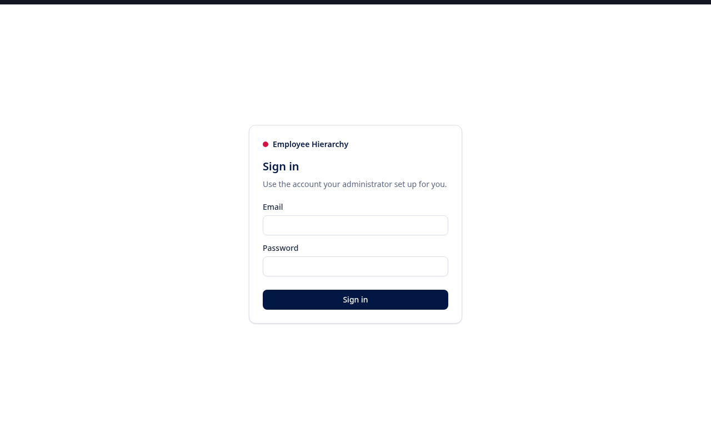

1. Open the site. If you are not signed in, you are taken to **Sign in**.
2. Enter your work email and your password, and choose **Sign in**.
3. You land where you were heading. If you followed a link to a page, you go straight there.

You stay signed in while you work, including across reloads and new tabs. To sign out, open the account menu (your email, top right) and choose **Sign out**.

### Your first sign-in

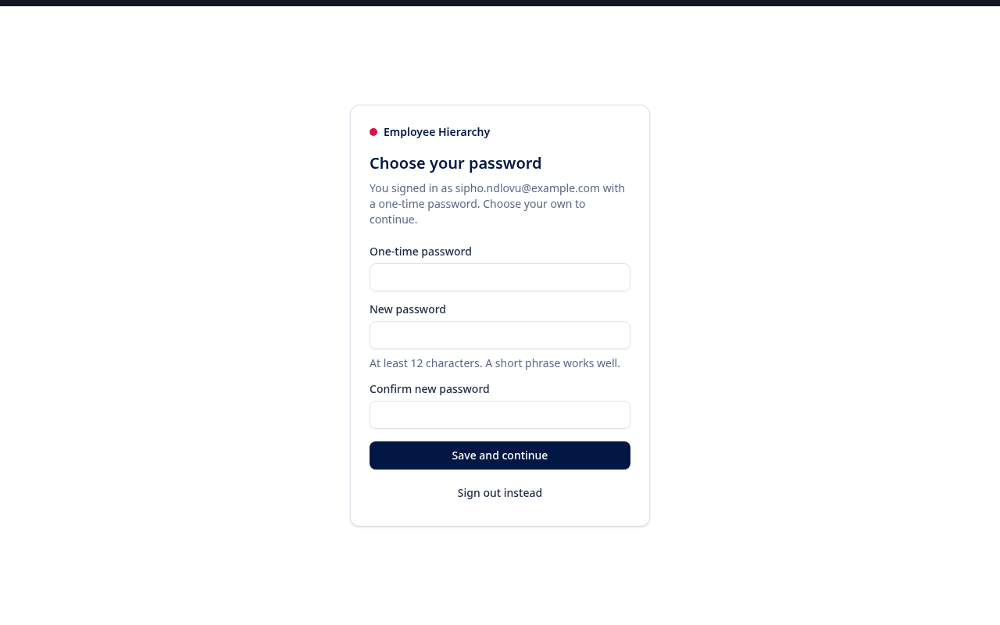

An admin gives you a **one-time password**: 16 letters and numbers. Sign in with it, and you are asked to **choose your own password** before anything else:

1. Type the one-time password again.
2. Choose a new password of at least 12 characters. A short phrase, such as four unrelated words, is easier to remember and harder to guess than a short jumble.
3. Type it again to confirm, and choose **Save and continue**.

The one-time password stops working once you have chosen yours. Until then, every page brings you back here.

### Changing your password

Open the account menu and choose **Change password**. Give your current password and your new one twice. You stay signed in where you are; anywhere else you were signed in is signed out.

**Forgotten your password?** Ask an admin to reset it. They give you a new one-time password, and you choose your own again.

**Too many wrong passwords:** after 10 failed attempts in 15 minutes, sign-in is paused for 15 minutes from that connection, even with the right password. Wait, then try again.

## 3. Home: you, your team and your tasks

The home page is about you:

- **Your profile**: your role, employee number and who you report to, with counts of your direct reports, open tasks and overdue tasks.
- **Your team**: you and the people who report to you, each with their number of open tasks. Select someone to jump to their tasks.
- **What you're working on**: your tasks.

### Your tasks

- **Add a task:** type it in the box at the top of **My tasks** and press **Add** or Enter.
- **Finish a task:** tick its box. It moves to the bottom and is struck through. Untick it to reopen it.
- Tasks show their due date; an overdue one is marked **Overdue** in red.
- Tasks are ordered: in progress first, then to do, then done; soonest due first.

### Your team's tasks

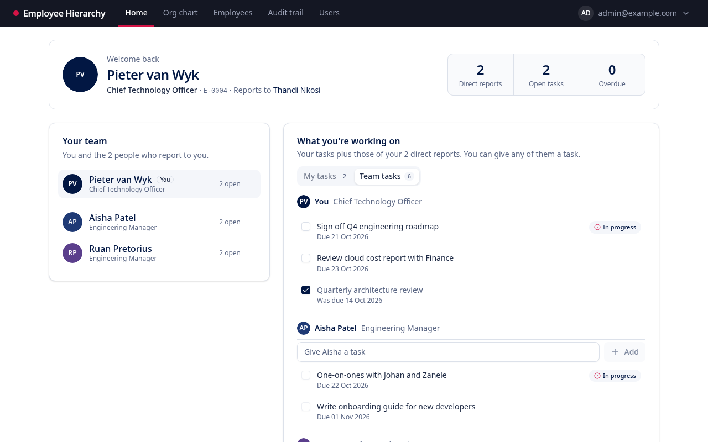

**Team tasks** shows your list followed by each direct report's. Their tasks are read-only to you; ticking them off is up to them.

**Give someone a task:** type into the box under their name (e.g. "Give Aisha a task") and press Enter. On their list it shows **From** and your name; on yours, **From you**. You can only give tasks to people who report directly to you.

## 4. The org chart

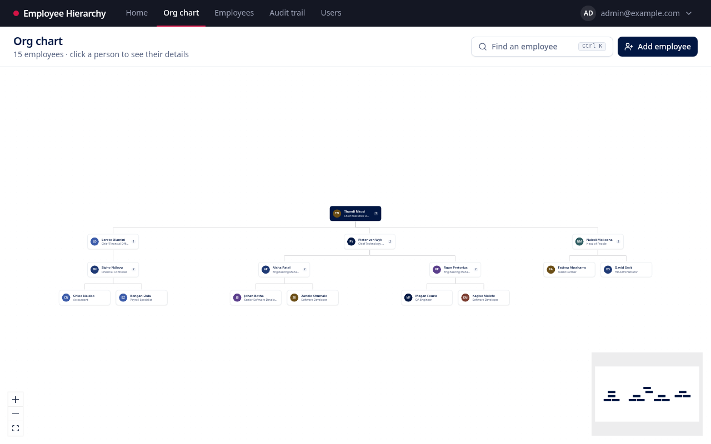

**Org chart** draws the whole organisation as a tree, top to bottom. Each card shows the person's picture, name, role and how many people report to them.

- **Move around:** drag the background to pan; scroll or use the **+** and **−** buttons to zoom. The **fit** button (bottom left) shows everything. The small map (bottom right) shows where you are.
- **See someone's details:** select their card. A panel opens with their number, email, birth date, salary (admins), manager and direct reports. Select a manager or report in the panel to move to them.

### Finding someone

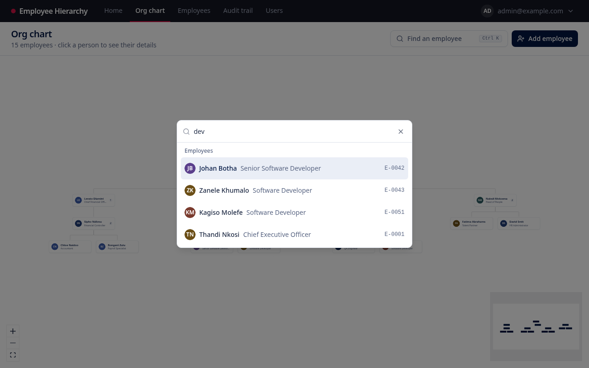

Choose **Find an employee** (or press **Ctrl K**, **⌘ K** on a Mac) and type part of a name, role or employee number. Choose a result to centre the chart on them and open their details.

### From the details panel _(admins)_

- **Edit** opens their record (see [section 6](#6-adding-and-editing-employees)).
- **Add report** adds a new employee who reports to this person.
- The **bin** deletes them (see [section 7](#7-deleting-an-employee)).

**"N people have no reporting manager":** shown when more than one person sits at the top of the chart. That can be deliberate during a restructure; otherwise, edit the extra people and give them a manager.

## 5. The employee table

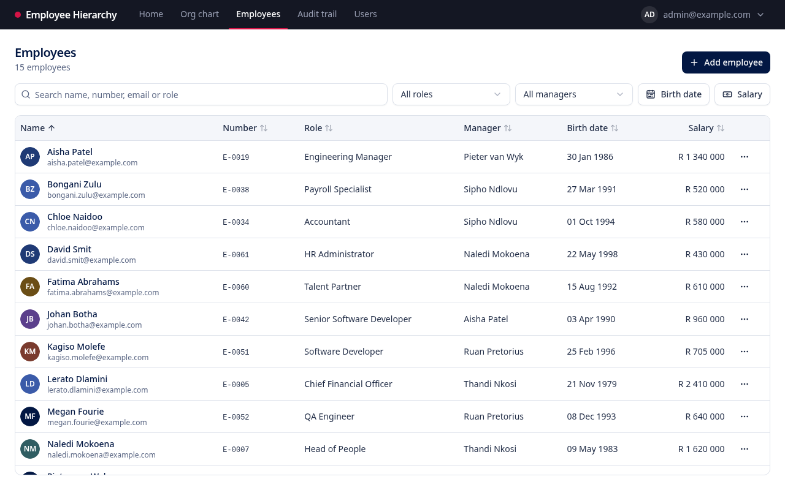

**Employees** lists everyone, with a count of how many match your filters.

- **Search** matches name, employee number, email and role. Several words must all match, so "aisha manager" finds Aisha Patel, Engineering Manager.
- **All roles** and **All managers** narrow the list to one role or one manager's direct reports.
- **Birth date** and **Salary** _(admins)_ filter by a range. Fill in either end, or both; an empty end means "no limit". Both ends are included.
- **Sort** by any column: select its heading. Select again to reverse it. Salary sorts highest first on the first select; the other columns start A to Z or earliest first.
- **Clear** removes every filter at once.

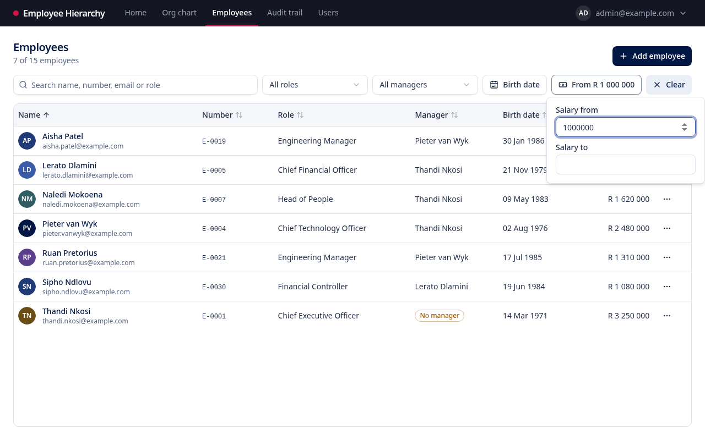

Admins have a **⋯** menu on each row to edit or delete that person.

As a regular user, salaries show as **Hidden**, and there is no salary filter or salary sort, since the order alone would reveal who earns more.

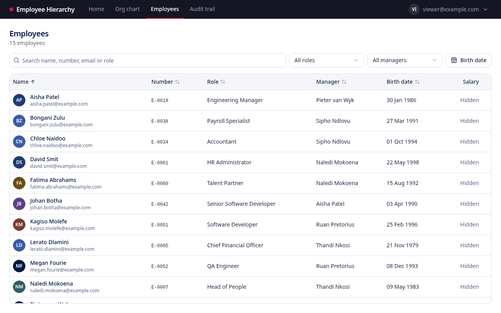

## 6. Adding and editing employees

_Admins only._

Choose **Add employee** (on the table or the org chart), or **Edit** on an existing person. Every field is required except the manager:

| Field                  | Rules                                                        |
| ---------------------- | ------------------------------------------------------------ |
| First name, Surname    | Up to 100 characters                                         |
| Employee number        | `E-` and four digits, e.g. `E-0042`. Must be unique          |
| Birth date             | After 1 January 1900, and before today                       |
| Email                  | A valid address, unique. Used to find their Gravatar picture |
| Role / position        | Up to 120 characters                                         |
| Annual salary (ZAR)    | Zero or more                                                 |
| Reporting line manager | Anyone, or **No manager (top of the hierarchy)**             |

**Choosing a manager:** the list never offers the person themselves or anyone who reports to them, however indirectly. Making someone their own manager, directly or through a chain, would create a loop, so the system refuses it.

Problems with a field show beside it. A clash with another record, such as an employee number or email already in use, shows at the bottom of the form. Nothing is saved until every problem is fixed.

**Adding someone gives them a login.** When you add an employee, the system also creates their login, as a regular user signing in with the email you entered. A window then shows their **one-time password**:

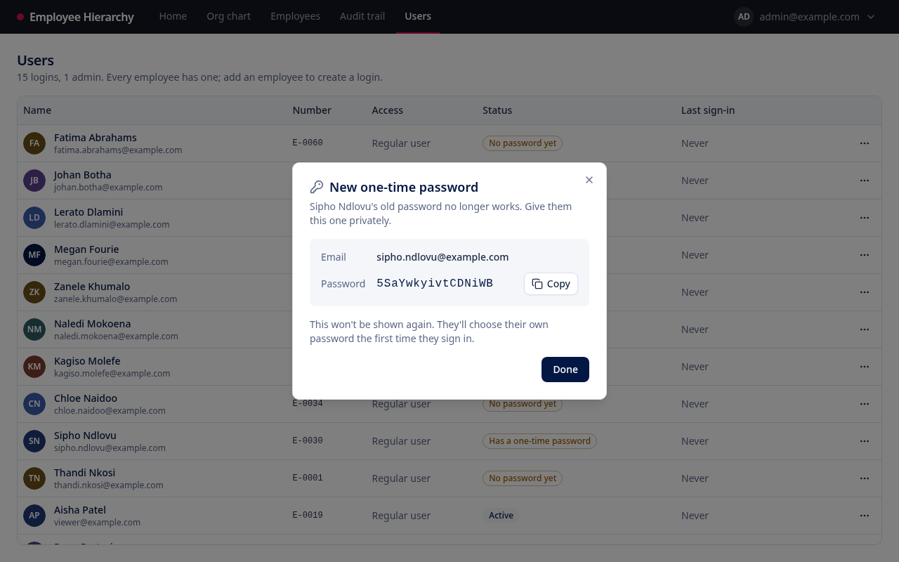

- Choose **Copy**, and give it to them privately, in person or by a private message, never in a shared channel.
- **It is shown only once.** Once you choose **Done**, nobody can see it again. If it is lost, reset their password from the Users page (section 8).
- They choose their own password the first time they sign in.

Changing an employee's email later does not change the email they sign in with.

## 7. Deleting an employee

_Admins only._

Choose **Delete** from a row's **⋯** menu or the bin in the org chart's details panel.

If the person manages anyone, you choose what happens to their team:

- **Move them up a level** _(default)_: they report to the deleted person's own manager.
- **Hand them over to someone else**: pick their new manager. You cannot pick the person being deleted or anyone in their team.

**Who moves** lists each direct report and their new manager before you confirm. For someone at the very top, moving up is not possible, so you must hand the team to someone.

Deleting is permanent, and deletes their login too: they are signed out at once. The audit trail keeps a record of the person and every move. You cannot delete your own record.

## 8. Managing who can sign in

_Admins only._

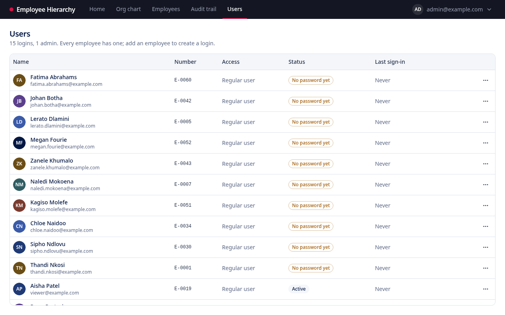

**Users** lists every login: the person, the email they sign in with, whether they are an admin, their status, and when they last signed in.

| Status                  | Meaning                                                     |
| ----------------------- | ----------------------------------------------------------- |
| Active                  | Can sign in with a password they chose                      |
| Has a one-time password | Has been given one and has not yet chosen their own         |
| No password yet         | Cannot sign in until you issue them a password              |
| Deactivated             | Blocked from signing in; their employee record is untouched |

Open the **⋯** menu on someone's row to:

- **Make admin**: they can then do everything you can, including managing access. It takes effect immediately; they do not need to sign in again.
- **Make regular user**: removes admin access straight away and signs them out.
- **Reset password** (or **Issue a password** if they have none): gives them a new one-time password, shown once, and signs them out. Their old password stops working.
- **Deactivate**: signs them out straight away and stops them signing in. Choose **Reactivate** to let them back in with their existing password.

Each asks you to confirm first.

**You cannot change your own access**: your row's menu is disabled. Ask another admin. There is always at least one admin, so the system can never be left with nobody able to manage it.

To give a new person access, add them as an employee (section 6). To remove someone entirely, delete their employee record (section 7); to block them but keep everything, deactivate them.

## 9. The audit trail

_Admins only._

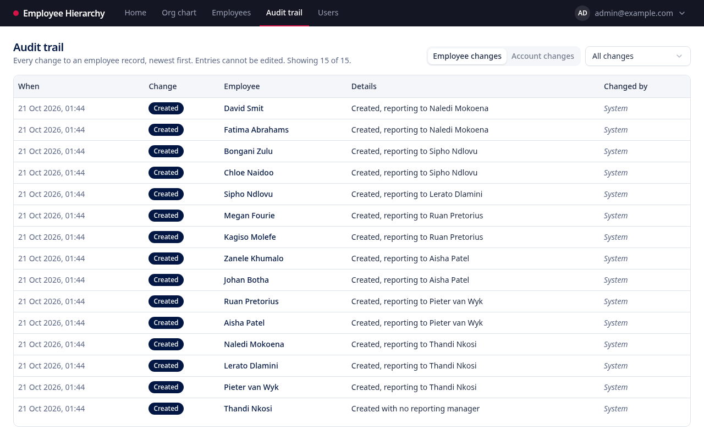

**Audit trail** lists every change to employee records, newest first: when, what kind of change, who it was about, which fields changed from what to what, and who made it. Changes made outside the app, such as the starter data, show as **System**.

- Use the list at the top right to show only one kind of change: created, updated, manager changed or deleted.
- Choose **Show older changes** at the bottom to load more.

**Account changes** shows changes to logins instead: created, access changed, deactivated, reactivated, password reset or changed, deleted, and who did each. Passwords themselves are never recorded.

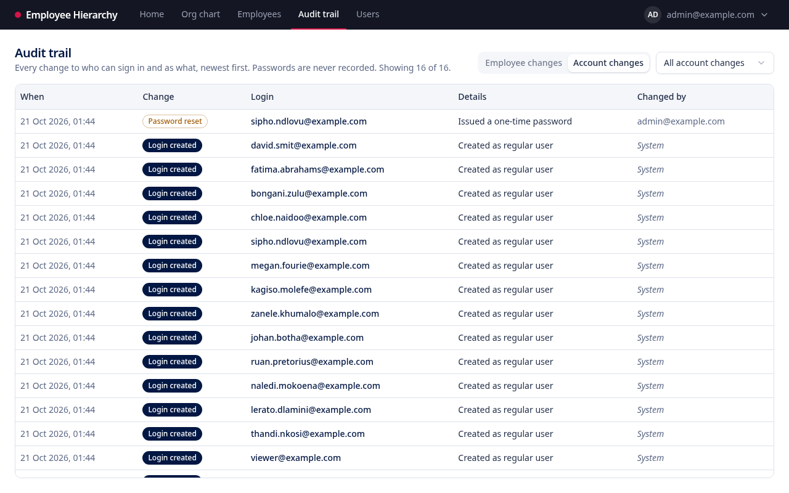

Every change is recorded by the database itself, so nothing can be changed without appearing here.

## 10. Profile pictures

Pictures come from [Gravatar](https://gravatar.com), a free service that links a picture to an email address:

1. The person signs up at gravatar.com with the same email address that is on their employee record, and uploads a picture.
2. The picture appears in the app wherever their name does.

Anyone without a Gravatar picture is shown with their initials on a colour.

The API also supports uploading a picture for an employee, which then takes priority over Gravatar. There is no upload screen in the web app yet.

## 11. Messages you might see

| Message                                                              | What it means                                                                                    |
| -------------------------------------------------------------------- | ------------------------------------------------------------------------------------------------ |
| That email and password do not match an account.                     | Check both and try again. For security, it doesn't say which was wrong.                          |
| Too many requests. Wait a moment and try again.                      | Too many attempts from your connection; wait up to 15 minutes.                                   |
| Your session has ended. Sign in again.                               | You were signed out, e.g. after a week away or after signing out elsewhere.                      |
| Another record already uses that employee number (or email address). | Numbers and emails must be unique.                                                               |
| That change would create a reporting loop: …                         | The chosen manager reports, directly or indirectly, to this person. The message names the chain. |
| … has no manager to move their team to.                              | When deleting someone at the top, choose **Hand them over to someone else**.                     |
| The audit trail is for admins                                        | Regular users cannot see the audit trail.                                                        |
| Managing users is for admins                                         | Regular users cannot see the Users page.                                                         |
| Your current password is not right.                                  | When changing your password, the current (or one-time) password you typed is wrong.              |
| The two passwords do not match.                                      | The new password and its confirmation differ.                                                    |
| Use at least 12 characters.                                          | Choose a longer password.                                                                        |
| This is the only active admin. Make someone else an admin first.     | The system always keeps one admin.                                                               |
| You can't change your own account.                                   | Ask another admin to change your access.                                                         |
| Could not reach the server.                                          | Check your connection, then retry.                                                               |
